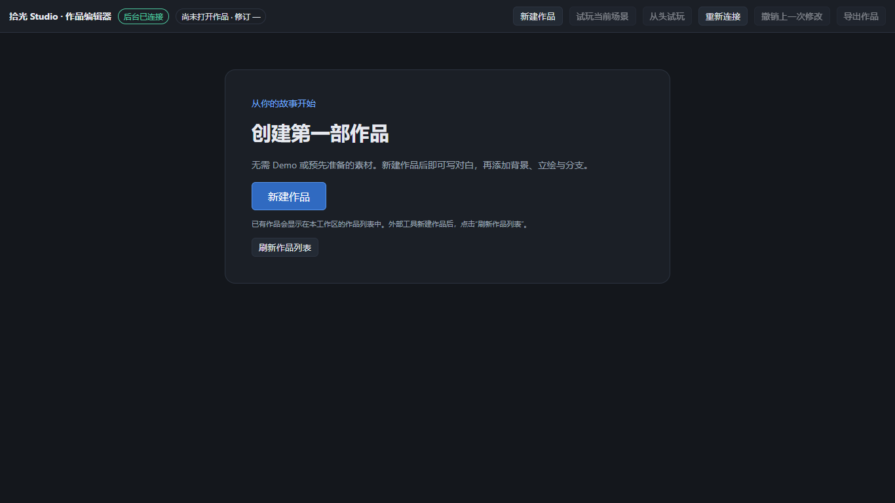
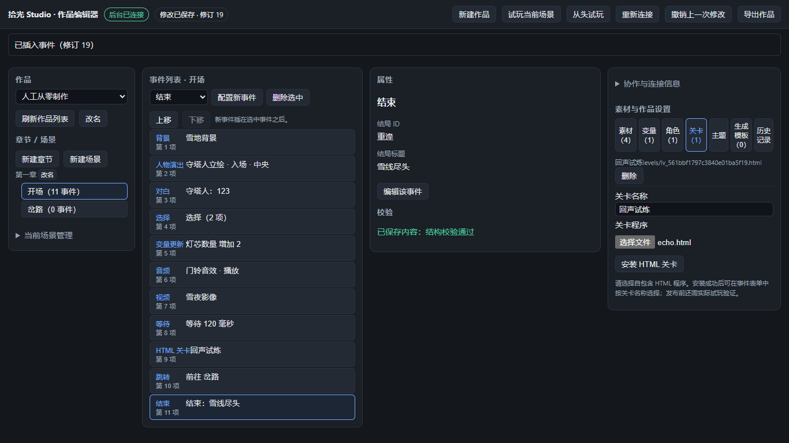

# 拾光 Studio

拾光 Studio **0.1.1** 是中文剧情作品的可视化编辑器与独立展示器。作者可以从空白工作区创建作品、写对白、添加场景与选择分支、导入图片和媒体、安装 HTML 关卡，再试玩和导出给玩家。人工编辑器与可选 AI/MCP 工具共用后台工程服务。

**先读 [中文使用手册](docs/USER_GUIDE.zh-CN.md)。** 基础创作无需 Demo 素材，也无需编辑工程 JSON 或记住内部编号。当前验证范围、修复与剩余限制见 [2026 年 10 月 1 日审计记录](docs/AUDIT_2026-10-01.md)。

## 下载与启动

从 [v0.1.1 Releases](https://github.com/senyonhu/shiguang-studio/releases/tag/v0.1.1) 下载 Windows 10/11 x64 便携包，完整解压到可写文件夹。

| 下载包 | 用途 | 启动 |
| --- | --- | --- |
| `ShiguangStudio-Editor-0.1.1-win-x64-export.zip` | 作者创作、试玩和导出 | 双击 `启动编辑器.cmd` |
| `ShiguangStudio-Player-0.1.1-win-x64.zip` | 接收作品并独立播放 | 放入导出的整个 `content` 文件夹，再双击 `启动展示器.cmd` |

便携包已带 Node **24.14.1** 及许可证，普通创作和播放无需另装 Node、Python 或 Docker，使用电脑已有的浏览器。启动器自动选择可用本机端口。关闭页面后，用相应“停止编辑器.cmd”或“停止展示器.cmd”结束服务。

默认编辑器和 Player 都是空白包。编辑器显示“创建第一部作品”；Player 在放入作品前显示“尚未载入作品”。C 编程关卡需要独立配置和启动真实执行器，不是 Studio 自带的编译能力。



## 从空白开始

1. 点击 **新建作品**，输入名称并“创建 / 保存”，得到第一章与开场。
2. 选择“对白”，点击 **配置新事件**，填写台词并“添加事件”。继续添加对白和“结束”。
3. 点击 **从头试玩**，确认对白和结局；通过名称选择器添加自己的素材、场景与分支。
4. 提交草稿后点击 **导出作品**，再点 **验证导出作品**。分发整个导出目录，或将其中整个 `content` 文件夹放入空白 Player。



完整步骤、11 种事件、媒体、关卡协议、存档、备份、协作和排障都在 [中文使用手册](docs/USER_GUIDE.zh-CN.md)。

## 源码开发

```powershell
npm ci
npm run typecheck
npm run studio:test:quick
npm run studio:test:core
npm run build:editor
npm run build:player
npm run studio:plugin
```

本机开发页面用 `npm run dev`；独立后台可运行 `node server/src/main.ts --workspace .studio-dev --port 0`。服务输出实际地址，用它打开 `studio-live.html?api=<编码后的后台URL>`。源码中的旧 Demo 根页面与 Studio 是不同入口。

Windows x64 便携打包使用经过官方 SHA256 与仓库许可核对的 Node 24.14.1。先完成上面的构建，再使用新输出子目录：

```powershell
node scripts/studio-portable-build.mjs --out release/my-v0.1.1-build
node scripts/studio-portable-check.mjs --release-dir release/my-v0.1.1-build --out artifacts/my-v0.1.1-check
```

添加 `--with-demo` 才为编辑器与展示器两包都加入样例，验收时也传同一选项。浏览器检查需要本机 Edge；具体命令和报告解释见手册。测试只说明被检查的行为，插件在外部 AI 宿主中的加载、所有媒体编码和任意关卡依赖均不应据此推断为已验证。

## 文档与代码入口

- [中文使用手册](docs/USER_GUIDE.zh-CN.md)：作者与玩家操作、进阶 HTML 关卡、开发与排障。
- [本次审计记录](docs/AUDIT_2026-10-01.md)：实际验证范围、修复与剩余限制。
- [后台与编辑器实施说明](docs/studio-backend.md)：API、事务、目录模型和开发验证，历史技术记录应结合本次审计读取。
- [studio-author 插件与 Skill](plugin/studio-author/README.md)：可选 MCP 制作入口，真实宿主加载仍需该宿主验收。
- [旧 Demo README](docs/LEGACY_DEMO_README.md)：保留旧网页版、Ren’Py 和 Judge0 路线的原始说明。
- `src/studio/live/` 人工编辑器，`src/runtime/` 共用内核，`src/player/` 展示器，`server/src/` 后台，`tests/studio/` 与 `tests/e2e/` 验证用例。

HTML 关卡运行在隔离 iframe，通过消息与受控 `fetch` 桥协作，不能读取父页存档或任意访问网络。当前没有变量条件分支、人物补间动画或通用玩家存档文件迁移。详细边界见手册和审计。
