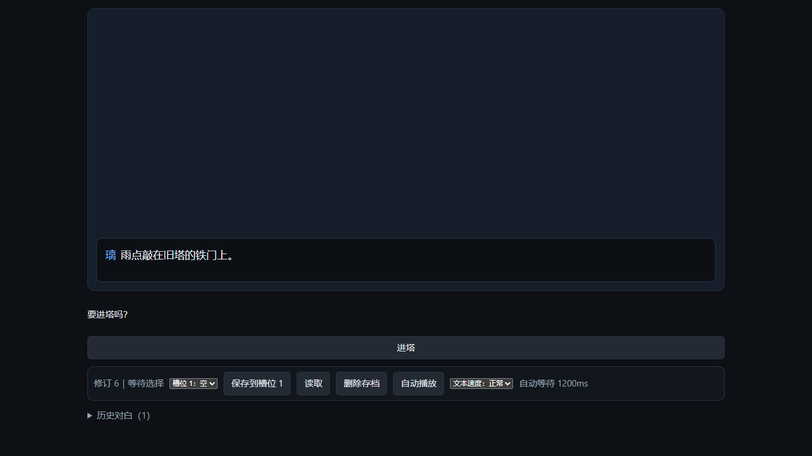
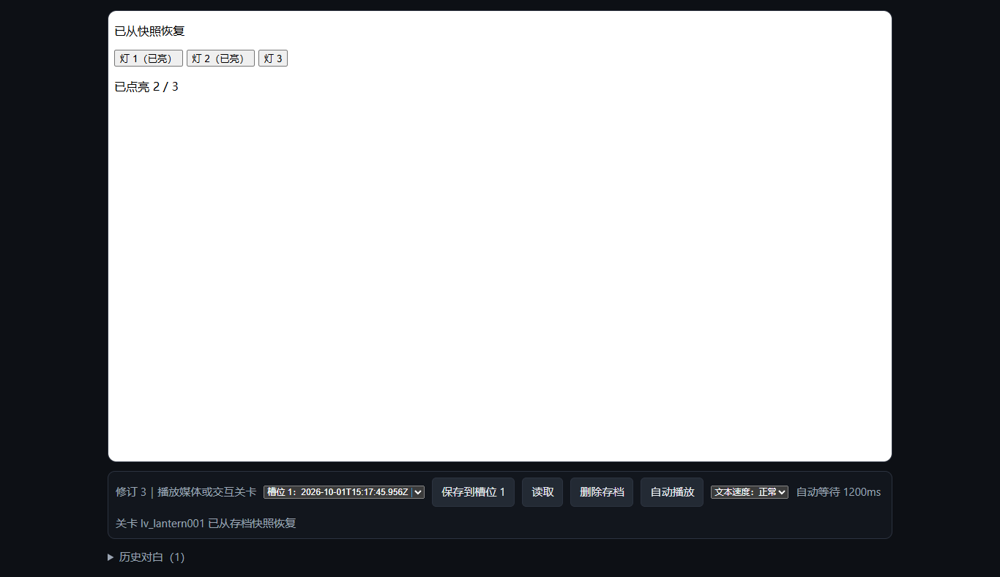

# 拾光 Studio 中文使用手册

本手册适用于 **拾光 Studio 0.1.1**，面向写故事的作者、接收作品的玩家，以及接入 AI 或开发 HTML 关卡的人。先完成一部只有对白和结局的小作品，再添加素材与分支，就能走通创作、试玩、导出和独立播放。基础创作使用中文表单和名称选择，不需要编辑工程 JSON 或记住内部编号。

下载入口是 [v0.1.1 发布页](https://github.com/senyonhu/shiguang-studio/releases/tag/v0.1.1)，源码在 [senyonhu/shiguang-studio](https://github.com/senyonhu/shiguang-studio)。本次修复与实际验证范围见 [2026 年 10 月 1 日审计记录](AUDIT_2026-10-01.md)。测试结果说明被检查的路径，不等于所有机器、素材和外部 AI 宿主都已验证。

## 下载与启动

Windows 10 或 11 的 64 位电脑可使用两个便携包：

| 包 | 用途 | 首次启动 |
| --- | --- | --- |
| `ShiguangStudio-Editor-0.1.1-win-x64-export.zip` | 作者制作、管理工程、试玩和导出 | 空白工作区，显示“创建第一部作品” |
| `ShiguangStudio-Player-0.1.1-win-x64.zip` | 接收并播放作者导出的作品 | 显示“尚未载入作品”，开始与继续按钮不可用 |

完整解压到有写入权限的文件夹，再双击编辑器包的 **启动编辑器.cmd**。启动器打开系统默认浏览器并连接后台；重复启动会打开已有实例，端口被占用时会另选端口。以实际打开的网址为准，不需要手工填写固定端口。不要直接打开 `studio-live.html` 或 `player.html`。

便携包已包含经过散列校验的 **Node 24.14.1**，普通创作和播放无需另装 Node、Python、npm 或 Docker。Node 许可位于 `runtime/node-LICENSE.txt`，前端许可位于 `licenses/`。浏览器由操作系统提供。需要编译或运行 C 的关卡另需独立执行适配器；Studio 不提供内置 C 编译服务。

默认包不带 Demo 工程或素材。开发者只有在构建时明确使用 `--with-demo`，才同时为编辑器和展示器加入样例；样例展示器文件名含 `Player-Demo`。下面的步骤适用于默认空白包。

## 空白编辑器的界面


后台连接后，欢迎页显示“创建第一部作品”和“新建作品”。此时试玩、导出及工程相关操作尚不可用。已有作品会出现在本工作区的作品列表；外部工具新建了作品后，点击“刷新作品列表”。


打开作品后，左侧是作品和章节场景，中间是事件列表，右侧是选中事件的属性、校验结果，以及“素材与作品设置”。顶部显示连接状态和保存状态，提供试玩、撤销与导出入口。修订是后台已保存内容的版本标记，你不需要手工填写它。

## 写出第一部作品

这条流程不需要图片、音频或 Demo。

1. 点击 **新建作品**，名称输入“我的第一部作品”，点击 **创建 / 保存**。编辑器生成“第一章”和“开场”。
2. 在“事件列表”上方选择 **对白**，点击 **配置新事件**。
3. “说话人”可留空，播放器会显示“旁白”。在“台词”写“我终于开始写自己的故事了。”，点击 **添加事件**。
4. 再添加一条对白，例如“下一段故事，会从这里出发。”。新事件插在当前选中事件之后；调整顺序时选中事件，再用 **上移** 或 **下移**。
5. 选择 **结束**，点击“配置新事件”。“结局标记（自定义）”填“完成”，“结局标题”填“第一部作品完成”，点击“添加事件”。
6. 顶部应显示 **修改已保存**。点击 **从头试玩**，在新窗口点击 **开始新游戏**，用 **继续（空格）**、空格或 Enter 推进，确认看见自己的结局标题。
7. 回到编辑器，点击 **导出作品**，再点击 **验证导出作品**，在本次导出的播放器中走一遍剧情。

若浏览器没有自动打开窗口，点击页面上的“打开试玩窗口”或“打开导出作品”。试玩使用打开时的已保存内容；修改后需要重新发起试玩。

## 修改 保存与草稿

选中事件，点击 **编辑该事件**，修改表单，再点击 **提交修改**。添加或修改成功后，内容已写入后台，不需要再找一个总“保存”按钮。主题单独使用“保存主题”。

编辑中的文字是草稿。出现“有未保存草稿”时，先提交，或明确点击 **放弃草稿**，再切换作品、场景或导出。要保留待处理内容，可点 **下载草稿备份**。当前没有把这个文件直接导回事件的按钮，可用备份查看并复制文字。

后台断开时，本页保留未提交草稿。用包内“启动编辑器.cmd”恢复服务，再点击 **重新连接**。若其他人或 AI 在你编辑期间改过作品，界面会提示冲突；先备份草稿，查看最新内容，再应用需要的修改，不要反复强行覆盖。

**撤销上一次修改** 撤销最近可撤销的提交。“历史记录”中可刷新历史，并用 **撤销这次修改** 选择一笔提交。撤销也是新提交；若后续修改依赖它，后台会拒绝有依赖冲突的撤销。删除场景或章节先显示确认操作，重大改动前仍建议备份工作区。

## 章节 场景与分支

“新建章节”用于整理较长作品。“新建场景”要求名称和所属章节。选中场景后，展开 **当前场景管理**，可以改名、删除、上下移动、移动到其他章节，或点击 **将此场景设为作品开场**。章节也可改名和调整顺序；空章节才显示删除入口。

章节和场景的排列用于组织内容，**不会自动把一个场景接到下一个场景**。运行到场景末尾就结束；要进入别的场景，需要添加“跳转”，或通过“选择”指定目标。

制作两条路线的故事：

1. 先新建“进门”和“离开”场景，分别写对白和结局。
2. 回到“开场”，添加“选择”，提示写“你决定怎么做？”。
3. 第一个选项文字填“推开门”，目标场景选“进门”。点击“添加选项”，第二项写“转身离开”，目标场景选“离开”。
4. 提交后从头试玩，分别检查两条路线。

一个选择支持 **1 至 6 个选项**。选目标场景后，目标事件留空表示从该场景开头开始；当前界面能按摘要选择当前场景的事件。跨场景的特定事件落点目前没有事件列表 UI，属于高级 MCP/API 操作。人工创作可把那个落点做成单独场景。

“跳转”使用同样的目标选择方式，不等待玩家点击。不要把连续跳转设置成无法停下的循环，内核会报告循环错误。



## 十一种剧情事件

| 事件 | 配置内容 | 播放时的行为 |
| --- | --- | --- |
| 背景 | 已导入的背景或插画素材 | 更换舞台背景，继续下一事件 |
| 人物演出 | 立绘、入场或退场或移动、左侧或居中或右侧 | 更新人物图层与位置 |
| 对白 | 说话人和台词，可选说话立绘 | 停留，等待继续 |
| 选择 | 提示、选项文字和目标 | 等待选择，再前往指定落点 |
| 变量更新 | 已创建的变量、设为或增加、值 | 更新运行中的变量 |
| 音频 | 素材、声道、播放或停止或淡出、循环、音量、是否等待 | 交给浏览器音频宿主执行 |
| 视频 | 素材、允许跳过、结束后与失败后策略 | 等待播放结束或允许的跳过 |
| 等待 | 毫秒数 | 到时再推进，0 毫秒立即继续 |
| HTML 关卡 | 已安装关卡、是否支持快照、可选初始参数 | 等待关卡完成或失败消息 |
| 跳转 | 目标场景或事件 | 立即跳到指定落点 |
| 结束 | 自定义结局标记、结局标题 | 显示结局并结束本次运行 |

“人物演出”的时长字段目前不产生补间动画，位置改变直接生效。变量可“设为”，数值变量还可“增加”；当前没有“根据变量判断条件”的事件，也没有自动把变量插入对白的模板语法。记录变量的能力不代表条件分支已经实现。

## 素材 角色 变量与主题

在右侧 **素材与作品设置** 选择对应页签。

**素材**：选择用途、文件和素材名称，点击“导入素材”。界面支持 PNG、JPEG、GIF、WebP 图片，WAV、MP3 音频，MP4、WebM 视频；单个文件最多 **24 MB**。扩展名正确不代表浏览器能解码，导入后仍要实际试玩。背景事件也可选择“插画 / CG”。透明人物立绘适合叠在背景上。

**角色**：填写角色名和可选说明，点击“新建角色”。已有角色可改名或删除。对白中可从角色列表选说话人；角色名与立绘是两项内容，创建角色不会自动在舞台上出现人物。还要导入立绘并配置“人物演出”。

**变量**：填写名称、类型和初值，点击“新建变量”。数值填写数字，文字填写文本，是非值使用 `true` 或 `false`。初值定义新游戏的起始状态；剧情中的变化用“变量更新”。删除仍被引用的变量会被校验拒绝，先修改使用它的事件。

**主题**：调整对白文字颜色、字号、左对齐或居中、菜单强调色。颜色使用 `#rrggbb`，字号为 12 至 48。点击 **保存主题** 后重新试玩或导出；未提交修改可取消。

**生成模板**：保存生成提示词和参数。当前 `fixture-local` 明确用于测试，不等于已接入商用生成服务，其视频测试产物不是可播放影片。实际创作可以先导入自己的媒体。提供方配置和候选接受流程见 [后台实施说明](studio-backend.md)。

## 音频与视频

声道包括 **背景音乐、环境音、音效、语音**。同声道的新背景音乐或环境音替换上一条。可播放、停止或淡出，音量范围为 0 至 1。要听完再继续的音效或配音，勾选“等待播完”并关闭“循环”，避免等待永不结束的循环。

浏览器可能阻止自动播放，先点“开始新游戏”后检查。背景音乐失败会提示并继续；阻塞音频失败会记录错误并继续。视频有播放控件，勾选“允许跳过”时才显示 **跳过视频**。

视频“播放结束后”可选继续或结束剧情。“失败后”可继续、结束或重新播放；重新播放最多重试一次，第二次失败报告错误并继续，避免永久卡住。发布前检查每个实际媒体文件，不能只检查它已经导入。

## 安装与制作 HTML 关卡

在“关卡”页签填写名称，选择自包含 `.html` 或 `.htm` 文件，点击 **安装 HTML 关卡**。再添加“HTML 关卡”事件，按名称选择关卡。安装成功不等于已加入剧情，也不等于程序成功执行。

界面与 `studio_install_level` 目前都安装单个 HTML 文件，没有通用 CSS、JS、JSON 依赖批量安装入口。最容易交付的关卡把脚本、样式和小型数据放在同一 HTML 中，不依赖 CDN；图片、音频和视频可通过素材导入加入作品。任意多文件依赖需先扩展并验收后台安装能力，不能当作当前作者可完成的流程。不要直接修改正式工程来绕过后台。

“支持快照”要求关卡定义与事件都允许，并且程序实现恢复；不支持时读档重开该关卡。正常进入关卡，包括循环再进入同一个关卡，都是新实例，不会带入上一关或上一轮的快照、结果。



下面只需要关卡开发者阅读，基础创作不需要这些代码。

### 关卡消息契约

HTML 运行在 `sandbox="allow-scripts"` 的 iframe 内，拥有不透明来源。可执行自身脚本，通过 `postMessage` 与宿主通信；不能读取或操作父页面 DOM、存档或凭据。`parent.postMessage` 是受支持的通信方式，不允许用 `parent.document` 接管播放器。

| 方向 | 消息 | 用途 |
| --- | --- | --- |
| 关卡到宿主 | `ready` | 就绪，等待初始化 |
| 宿主到关卡 | `init` | 含协议版本、实例标记、事件的 `payload` 和可选 `snapshot` |
| 关卡到宿主 | `checkpoint` | 用 `payload` 上报可序列化的进度 |
| 关卡到宿主 | `complete` | 上报结果，宿主推进剧情 |
| 关卡到宿主 | `error` | `payload` 含 `code` 与 `message`，失败后剧情继续 |

协议版本为 **1**。收到 `init` 后保存其 `levelInstanceId`，后续消息携带这个标记。`messageSeq` 在同一实例内递增，`requestId` 标识消息；同一次重试复用编号，新进度使用新编号。宿主会丢弃重复或迟到消息。接收初始化时检查 `event.source === parent`，不能按普通同源 iframe 判断不透明来源。

最小关卡可保存为 UTF-8 的 `level.html` 并在界面安装，不需要 C 执行器：

```html
<!doctype html>
<html lang="zh-CN">
<head><meta charset="utf-8"><title>第一关</title></head>
<body>
  <p id="state">等待初始化</p>
  <button id="finish" disabled>完成关卡</button>
  <script>
    let instanceId = null;
    let seq = 0;
    const button = document.getElementById('finish');
    const send = (type, payload) => {
      seq += 1;
      parent.postMessage({
        type, protocolVersion: 1, levelInstanceId: instanceId,
        requestId: type + '-' + seq, messageSeq: seq, payload
      }, '*');
    };
    window.addEventListener('message', (event) => {
      if (event.source !== parent || event.data?.type !== 'init') return;
      instanceId = event.data.levelInstanceId;
      seq = 0;
      document.getElementById('state').textContent = '关卡已开始';
      button.disabled = false;
    });
    button.onclick = () => {
      button.disabled = true;
      send('complete', { completed: true });
    };
    parent.postMessage({ type: 'ready', protocolVersion: 1 }, '*');
  </script>
</body>
</html>
```

支持中途存档时，在操作产生进度后发送 `checkpoint`，在 `init.snapshot` 非空时恢复输入、画面和进度。宿主保存快照，关卡不要用 `localStorage` 存进度。初始化超时、程序加载失败或协议不兼容时播放器会报错并继续剧情，正式作品应修复这些错误；“已跳过关卡”不能视为通关。

### 关卡的受控网络访问

直接网络连接受内容安全策略限制。使用标准 `fetch()` 时，宿主注入的桥只允许：

| 目标 | 方法 | 条件 |
| --- | --- | --- |
| 当前作品内容根下的 `assets/` 和 `levels/` | `GET`、`HEAD` | 不得越级、读取隐藏路径或重定向到其他地址 |
| 显式配置的本机 C 执行器 `/health` | `GET` | 地址来自该关卡事件的初始参数 |
| 同一执行器 `/run` | `POST` | 只允许这个运行端点 |

其他域名、制作 API、任意本机端口、WebSocket、直接 XMLHttpRequest、内嵌 frame、worker、插件对象和表单外发不在支持范围。换成其他网络 API 不会获得权限。不要为关卡放宽后台 CORS 或使用 `allow-same-origin`。

需要 C 的关卡必须独立启动并验证执行适配器，然后在“初始参数”明确填写 JSON，例如：

```json
{"runner":"http://127.0.0.1:5201"}
```

`5201` 只是示例，填写实际端口。执行器来源须为 `http`，主机限定 `127.0.0.1`、`localhost` 或 `[::1]`；地址不能含凭据、其他路径、查询参数或片段。MCP/API 也可用对象形式传入 `initPayload`。UI 文本会原样传给关卡，程序需要在收到字符串时自行解析 JSON；桥会解析它来核对授权执行器。

桥不安装编译器或启动服务，也不改变适配器请求/响应协议。适配器仍需允许来自实际播放器来源的受控请求，不要开放任意来源。开发者负责提交源码、读取真实编译/运行结果、显示错误并判定完成，不能用模拟 `complete` 冒充 C 通过。

桥限制并发、请求体和响应体大小，离开关卡时中止未完成请求。此次契约覆盖内联脚本、经典脚本及内联 module；不透明来源下的外部 ES module import 不在交付承诺内，字体等资源也可能受浏览器来源规则约束。优先内嵌依赖，不要扩大宿主权限。

## 试玩与导出作品

**试玩当前场景** 从当前场景开头开始，**从头试玩** 使用作品开场。实际播放器能检查画面、选择、媒体和关卡。结构校验只能检查内容关系，不能证明文件可解码、执行器正常或依赖成功加载。

提交事件与主题草稿，确认“修改已保存”，查看校验区。点击 **导出作品**，页面显示导出修订、目录、是否附带便携运行环境。**打开导出目录** 可在支持该能力的本机环境打开文件夹；失败时按页面显示的相对路径寻找。

编辑器工作区位于 `data/workspace/`，导出目录在对应作品的 `exports/` 子目录，包含 `content/`、播放器、清单和启动文件。**验证导出作品** 打开本次导出；继续创作不会自动更新旧导出，需要重新导出。

压缩整个导出目录分发前，请确认：

- 导出版本就是打算发布的最终版本。
- 无缺失素材、缺失关卡程序或敏感内容警告。
- 从开场走过各分支，检查每段媒体和关卡；依赖和 C 执行器在接收环境可用。
- 页面说明包含便携环境；若没有，接收方需提供 Node 或使用独立便携 Player。

高级清单字段为 `revision`、`playerIncluded`、`portableIncluded`、`missingAssets`、`missingLevels`、`sensitiveHits`，便于工具检查。人工作者优先使用页面提示和实际播放结果。

## 把作品放入独立展示器

接收方可以完整解压作者交付目录并双击 **启动展示器.cmd**，也可使用空白 Player 包。

“尚未载入作品”是空白 Player 的正常状态。先停止展示器，将导出目录中的 **整个 `content` 文件夹** 复制到 Player 解压目录，替换空 `content`，再启动。不要复制作者工程目录或只复制 `content.json`，素材与关卡都需要一并带走。

替换作品时先备份并移走旧 `content`，再放入完整新目录，避免旧素材残留。模板与内容须兼容，内核版本不兼容会提示重新导出。源码修改后需重建程序包，复制出来的旧包不会自动更新。

## 玩家操作与存档

标题页提供 **开始新游戏** 与 **继续上次进度**。普通对白用“继续（空格）”、空格或 Enter 推进，选择点选项，关卡按自身说明操作。自动播放只推进普通对白，不替玩家选择或完成关卡。

工具栏有 **3 个存档槽**，先选槽位，再用“保存到槽位…”、“读取”或“删除存档”。标题页继续默认读取槽位 1；槽位 2 或 3 可先开始游戏，在工具栏选择后读取。存档在当前浏览器按作品区分，包含历史、选择、变量、舞台、剩余等待、结局和允许的关卡快照；读取失败保留当前进度。

存档不是作者工程，也不自动同步到其他电脑、浏览器或网址。本地存储按来源区分，改变端口或浏览器可能看不到原存档；清理网站数据会删除进度。当前没有通用存档文件导入导出 UI，复制作品目录也不会迁移玩家进度。

**自动播放** 可开关。“文本速度”慢、正常、快对应普通对白自动推进等待约 2200、1200、500 毫秒，不是逐字打字动画。展开 **历史对白** 可查看已读台词。

读档检查作品身份、内容修订、内核版本和格式。其他作品、旧修订、损坏或缺少作品标记的旧存档会被拒绝。正在播放的音视频读档后从头播放，不恢复 `currentTime`；活动背景音乐和环境音会恢复。HTML 快照由关卡程序自行恢复，否则会重开。

运行错误看页面错误码与消息。非阻塞媒体失败可能继续剧情；跳转错误等严重错误可点 **返回标题页**，修复并重新导出后再开始。结局的 **重新开始** 返回标题页。存储空间不足或禁止本地存储时保存会失败，不能把失败提示当成已存档。

## 备份 更新与迁移

提交草稿，关闭页面，运行 **停止编辑器.cmd**，再复制整个 `data/workspace/` 备份。它包含作品、列表、历史和后台运行数据。仅复制 `exports/` 只能备份发布作品，不能恢复完整作者工程。私有工作区可能有配对密钥，不要上传公开仓库或随作品分发。

更新时解压到新目录。停止旧版、备份工作区，再将工作区复制到新包 `data/workspace/`，启动检查作品。不要让两个后台同时写同一工作区；确认打开、修改、导出正常后再清理旧副本。关闭浏览器不等于停止后台，应使用停止脚本。

展示器用 **停止展示器.cmd**。`install.cmd` 可复制到用户目录并创建快捷方式；便携使用不需要安装。安装版与便携版使用各自目录的数据，卸载前先备份作者工作区。

旧浏览器 Studio v1 工程 JSON 有迁移工具，先预览再执行：

```powershell
# 源码仓库根目录；迁移到独立工作区检查
node scripts/studio-migrate.mjs --input "旧工程.json" --dry-run
node scripts/studio-migrate.mjs --input "旧工程.json" --workspace ".studio-migrated" --json "migration-report.json"
```

迁移保留输入文件并列出不支持项。旧关卡要重新安装，外部素材要重新导入，旧试玩存档不承诺兼容。旧网页版和 Ren’Py Demo 是其他运行路线，见 [源码仓库中的旧 Demo 说明](https://github.com/senyonhu/shiguang-studio/blob/main/docs/LEGACY_DEMO_README.md)；它们的 Docker、Judge0 或 Python 要求不适用于普通 Studio 便携创作。

## AI 与 MCP 协作

AI 是可选入口，人工创作不依赖它。人工 UI 与 MCP 通过同一后台服务写内容。[studio-author 插件](https://github.com/senyonhu/shiguang-studio/tree/main/plugin/studio-author) 附有制作 Skill；便携包中位于 `app/plugin/studio-author/`。

支持自定义 stdio MCP 的宿主可使用 `mcp.cmd`：命令为系统 `cmd.exe`，参数为 `/d /c` 和该文件完整路径，正确处理空格。具体格式依宿主而定；插件清单和 Skill 在所有目标宿主中加载尚未验证，文件存在不代表安装成功。

首次后台启动生成工作区配对密钥，适配器用它建立有作用域的会话。文件在 `.studio-service/credentials/pairing.key`；基础作者无需手工处理，接入时不要将密钥放进网址、截图、公开仓库或作品包。核对实际工作区、服务版本和地址，不要沿用别人的固定端口与资源路径。

展开 **协作与连接信息**，在“AI 会话写入”中用 **暂停写入** 或 **恢复写入** 管理会话。暂停阻止后续写入，不撤销已完成修改；恢复后 AI 仍须读取当前版本。不要绕过后台来避开暂停。

给 AI 明确作品、改动范围和素材来源。它应先读修订，再用稳定请求标记提交；未知结果先回读，冲突先重新规划，不能盲目覆盖。人工有未提交草稿时，应等待或选择其他无冲突内容。Skill 区分内容事务、结构快照、像素截图和真实浏览器验收，模拟宿主完成不能证明关卡运行。

产品代码修复与内容制作是不同范围，需要修复编辑器或展示器时应明确授权；普通写故事不自动授权重写产品。具体 Skill 与工具参数在插件目录，API 细节见 [后台实施说明](studio-backend.md)。

## 开发 构建与验收

下面适用于源码开发者，便携用户不需要执行。开发 Node 须支持 TypeScript 入口；便携打包固定使用 **24.14.1 的 Windows x64 `node.exe`**，校验官方散列与仓库许可。更换版本前必须同步这些文件，不能只换二进制。

```powershell
# 在源码仓库根目录
npm ci
npm run typecheck
npm run studio:test:quick
npm run studio:test:core
npm run build:editor
npm run build:player
npm run studio:plugin
```

开发页面与后台分别启动，使用实际服务 URL：

```powershell
npm run dev
# 另一个终端，服务输出发现地址
node server/src/main.ts --workspace ".studio-dev" --port 0
```

打开 `studio-live.html?api=<编码后的后台URL>`。浏览器测试默认使用本机 Edge 与 `127.0.0.1:5173` 开发页面；保持开发服务运行后执行：

```powershell
npx playwright test tests/e2e/studio-human.spec.ts tests/e2e/studio-live.spec.ts tests/e2e/p2-player.spec.ts --reporter=list
```

先构建 editor、player、plugin，再使用新的输出子目录，避免覆盖用户数据和既有 ZIP：

```powershell
# 默认空白包
node scripts/studio-portable-build.mjs --out "release/my-v0.1.1-build"
node scripts/studio-portable-check.mjs --release-dir "release/my-v0.1.1-build" --out "artifacts/my-v0.1.1-check"

# 可选示例，editor 与 player 同时加样例
node scripts/studio-portable-build.mjs --out "release/my-v0.1.1-demo" --with-demo
node scripts/studio-portable-check.mjs --release-dir "release/my-v0.1.1-demo" --out "artifacts/my-v0.1.1-demo-check" --with-demo
```

便携验收在隔离解压副本检查空白界面，通过 UI 创建作品、保存重启、导出，再放入空 Player 实际播放，不直接改正式工作区。浏览器测试与便携验收需要可用浏览器。以本次报告为准，失败、跳过、未运行不能写成通过。发布还须计算最终 ZIP 的 SHA256 并核对清单；旧 Demo 截图不替代空白人工流程验收。

## 常见问题与当前限制

| 现象 | 处理 |
| --- | --- |
| 空白编辑器没素材 | 正常，先新建作品写对白，需要时导入自己的文件 |
| “连接已断开” | 保留草稿，启动编辑器，再点重新连接，检查 `data/launcher.log` |
| 按钮不可用 | 检查连接、作品与场景，以及未提交事件或主题草稿 |
| 提交失败 | 阅读字段和页面提示，核对名称、台词、数值与目标 |
| 修订冲突 | 备份草稿，查看最新内容后重新应用必要修改 |
| Player 尚未载入作品 | 放入导出包的整个 `content`，刷新或重新启动 |
| 媒体不显示 | 检查用途、文件完整性、浏览器编码支持，在本次导出包重测 |
| 关卡等待或报错 | 检查 `ready`、协议与依赖；C 关卡另需真实执行器 |
| 关卡网络拒绝 | 核对允许目录或显式 runner 端点，不扩大 CORS 或 iframe 权限 |
| 读档失败 | 核对作品、修订与内核；损坏或旧无作品标记存档需重开 |
| 换电脑或端口后没存档 | 进度在原浏览器来源，复制作品不会带走进度 |
| 保存失败 | 释放空间或解除存储限制后明确再保存 |
| 更新仍是旧界面 | 停止旧服务，确认打开新解压包；源码不自动更新旧包 |

0.1.1 的边界包括 Windows x64 便携交付，以及尚未提供的完整时间轴、人物补间动画、变量条件分支、通用玩家存档文件迁移、整个关卡目录上传 UI。真实媒体提供方、复杂关卡依赖、外部 C 执行器和具体 AI 宿主要单独配置验收。代码签名、MSI/NSIS 安装程序也未提供。更细的已知问题与证据范围见 [审计记录](AUDIT_2026-10-01.md)。
