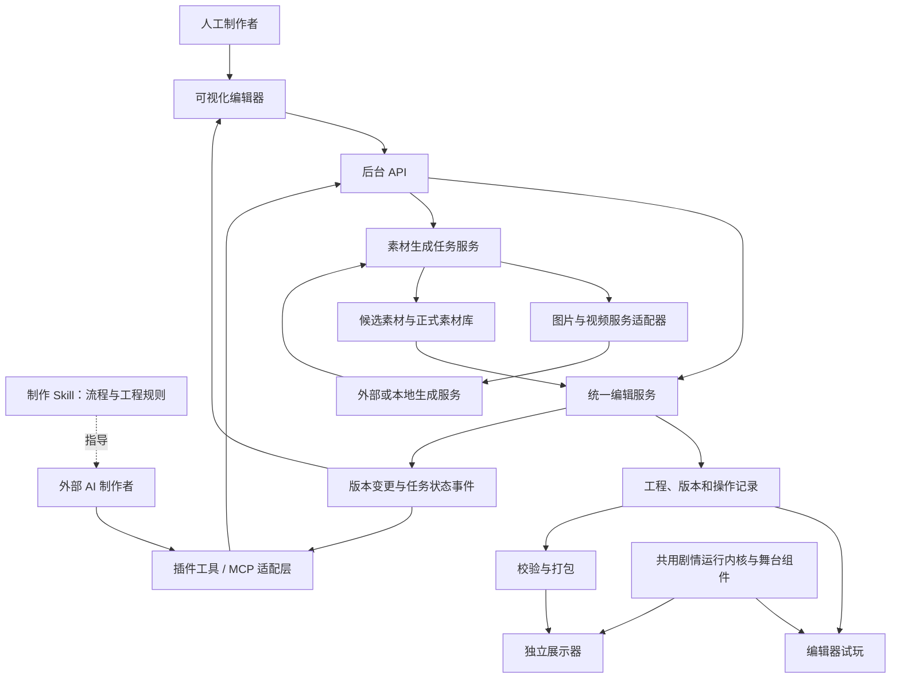

# 拾光 Studio：人工可视化编辑、外部 AI 经 API 制作的编辑器及展示器完整方案

日期：2026-09-30。修订：v2，后台 API 与 Skill/插件接入。状态：待实施的产品与技术方案。

本文以用户最新要求为准：外部 AI 必须通过后台 API、Skill 配套工具或插件完成制作，禁止使用桌面自动化、鼠标键盘模拟或浏览器 UI 自动化作为制作入口；人工使用可视化编辑器。两种入口共用后台编辑服务，同时预留根据提示词调用其他 AI 生成图片、视频的接口。本次交付为方案修订，不代表后台、Skill 或插件已经实现或安装。

## 1. 产品目标和范围

建设五个相互配合的部分：

1. **可视化编辑器**：供人工打开工程、创建章节、导入素材、编辑事件、配置分支、调用生成服务、试玩、保存和导出；同步呈现后台 AI 改动。
2. **展示器**：面向玩家，加载发布内容，执行剧情、演出、关卡和存读档。编辑器的试玩使用相同运行内核与舞台组件。
3. **素材生成连接层**：接受提示词和参考素材，调用可替换的图片、视频服务，管理异步任务，将产物落入工程素材库。
4. **后台工程服务/API**：统一执行读写、事务、历史、校验、预览、打包和任务管理；可在编辑器窗口关闭时运行。
5. **AI 制作插件与 Skill**：插件将后台能力包装成 AI 工具；Skill 提供制作流程、工程规则及工具使用指导。二者不重复实现工程读写逻辑。

AI 制作者与素材生成模型是两个角色。前者调用插件工具/API 执行制作流程；后者根据请求生成资源。编辑器不要求自带通用聊天助手。人工点击“生成图片/视频”与 AI 调用生成工具，最终进入相同后台任务服务。

默认实施范围：Windows 桌面优先、单作者本地工程、可离线编辑和运行普通内容。云端生成需要网络。多人实时协作、移动端编辑、云端账户平台和商店不列入首版；数据模型为后续扩展保留边界。

### 1.1 必须跑通的用户流程

用户向外部 AI 描述“制作雨夜进入旧塔的一章，配两张背景、一个人物入场和一段转场视频”。AI 按 Skill 指导调用插件工具，查询工程、创建章节和事件、提交图片/视频任务、绑定素材、运行预览检查并保存。编辑器打开时实时显示改动；关闭时也能制作，重新打开后读取相同工程版本。用户可以直接修改并继续制作。

“AI 在聊天里输出剧本”“Skill 只有说明而无可调用工具”“AI 绕过后台直接改工程文件”不能单独算作上述流程完成。后台接口不可用时返回明确错误，不回退到桌面自动化。

## 2. 已有基础与需要补齐的能力

依据当前 `src/studio/model.ts` 和 `docs/studio-demo.md`：

| 已有基础 | 正式方案中的处理 |
| --- | --- |
| Vue/TypeScript 工作台、舞台预览和表单编辑 | 沿用技术基础，拆分可维护的界面与领域模块 |
| 对白、选择、关卡、结束四类节点 | 迁移为章节/场景及事件序列，并逐项扩展执行能力 |
| 图片素材、基础校验、导入导出 | 扩展为磁盘资源索引、完整工程、音视频和引用检查 |
| 星图关卡及进度通信 | 抽出关卡宿主协议，用第二种玩法验证通用性 |
| 预置 AI 修改示例及冲突提示 | 仅保留有用的变更展示思路，不能当作外部 AI 操作能力 |
| 浏览器本地保存；最多 300 节点、30 素材 | 建立磁盘工程、增量保存和规模测试，再调整限制 |

仓库同时包含早期网页版和 Ren’Py 单机版。首版工作台与展示器沿用网页 Studio 方向；Ren’Py 保留为已有作品与参考，不同时维护两套权威剧情运行状态。需复用的 C 评测能力由独立适配器接入。

开发开始先列出引擎“已支持、需适配、需新增”的能力表。编辑器只将可被当前引擎实际执行的功能显示为可用。

## 3. 总体结构



首选实现组合是现有 Vue 3/TypeScript 界面、Electron 桌面外壳、独立本地工程服务和 MCP 工具适配层。后台拥有唯一写入权，窗口只作为客户端；后台可独立启动，关闭界面是否保留后台任务由明确设置控制。第一阶段验证无界面 API 制作、界面同步、媒体播放和打包体积。

Electron 官方说明主进程管理窗口及本地能力、渲染进程承载界面，适合上述职责划分；这是结合本项目作出的选型判断。[进程模型](https://www.electronjs.org/docs/latest/tutorial/process-model)

模块建议：`editor-ui`、`editor-core`、`project-api`、`project-store`、`ai-tools`、`authoring-skill`、`story-runtime`、`stage-player`、`level-host`、`asset-library`、`media-jobs`、`provider-adapters`、`desktop-host`、`publisher`。作为同一仓库内的模块建设，首版无需部署一组远程服务。

## 4. 编辑器界面与人工功能

参考橙光已核实的工作区分工，采用可调整宽度的桌面布局：

| 区域 | 首版功能 |
| --- | --- |
| 顶部工具栏 | 新建、打开、最近工程、保存、撤销/重做、检查、当前场景试玩、全篇试玩、导出 |
| 左侧工程区 | 章节/场景树；新增、复制、排序、移动、重命名；全局搜索 |
| 素材区 | 背景、角色、CG、音频、视频分类；缩略图、筛选、标签、导入、引用位置和生成入口 |
| 中央舞台 | 当前画面预览；对象选择、位置与层级调整；横竖屏与安全区域参考 |
| 右侧事件列表 | 对白、演出、条件、选择、关卡等事件；多选、复制、插入、移动和折叠 |
| 属性/制作区 | 编辑选中事件；插入命令；提示词与生成参数表单 |
| 底部状态区 | 保存状态、当前事件、校验问题、后台任务和操作历史 |

复杂功能采用独立面板：角色设定、变量表、界面主题、关卡配置、生成任务中心、版本恢复。AI 会话、后台连接和操作状态显示在工具栏，提供暂停该 AI 会话写入的入口，不要求一个永久占用主编辑区的聊天面板。

事件列表提供“剧情视图”和“详细事件视图”，共用底层数据。视图切换不删除或转换掉高级内容。舞台拖动同时有坐标输入框；需要批量填写时提供表格和多项编辑入口。

## 5. 外部 AI 的后台 API、插件与 Skill

### 5.1 唯一制作路线与职责

外部 AI → 制作 Skill 指导 → 插件工具调用 → 后台 API → 统一编辑服务 → 工程持久化与变更通知。人工界面调用同一后台。新建章节、素材导入、事件编排、分支、主题、生成、校验、预览和打包均须有明确 API，不能存在只有点按钮才能完成的核心功能。

| 层 | 职责 | 不承担的职责 |
| --- | --- | --- |
| Skill | 解释工程结构、选用工具、分章制作、处理冲突、检查并报告结果 | 不提供凭据、执行权限或后台运行能力 |
| 插件 | 分发 Skill、工具声明和连接配置，使兼容的 AI 客户端发现能力 | 不保存第二份剧本，不单独实现编辑规则 |
| 工具适配层 | 将带参数规范的工具调用转换为后台请求，返回结构化结果 | 不模拟界面动作，不绕过后台改文件 |
| 后台 API | 校验、授权、并发、事务、任务和统一错误返回 | 不依赖窗口焦点、选中项或像素位置 |
| 可视化编辑器 | 人工编辑、查看 AI 修改、差异、问题和预览 | 不成为后台执行的必要前提 |

建议将工具适配层实现为 MCP 服务。MCP 允许向模型暴露带参数规范的工具，适合包装这些领域操作；具体协议版本须与目标客户端验证并锁定。[MCP 工具规范](https://modelcontextprotocol.io/specification/2026-07-28/server/tools)

### 5.2 本地连接与后台生命周期

首版插件通过本地 stdio MCP 进程连接 AI 客户端，适配器访问本机工程服务。工程服务提供版本化 HTTP API 和 SSE 变更流，默认只监听 `127.0.0.1`；这是本项目 API 的设计，不是将 SSE 作为 MCP 传输。不同客户端的 MCP 连接方式需实际测试。[MCP 传输规范](https://modelcontextprotocol.io/specification/2026-07-28/basic/transports)

后台是独立本地进程，由编辑器或插件共用的启动管理器发现/启动。每个用户仅维护一个指定工作区服务实例；采用单实例锁、协议握手和健康检查，避免两个进程同时写同一工程。发现记录不包含明文凭据。

本地配对建立有作用域的会话，认证来源决定操作者身份。会话限定已授权工程及 read、edit、generate、preview、export 等操作。服务验证 Host/Origin、令牌和请求结构；令牌不出现在网址、工程、提示词或日志中。首版不开放公网或局域网访问。

编辑器窗口关闭时，只要后台仍运行，AI 可以继续制作和查询长任务。后台不可用时，插件可按已配置的启动策略恢复服务，失败则返回 `BACKEND_UNAVAILABLE`。不能退回 GUI 操作或直接文件写入。

### 5.3 工具集合与后台端点

工具针对制作对象，不暴露通用 shell、任意 SQL 或任意文件覆写。以下名称和路由均为拟议规范；OpenAPI/JSON Schema 是实现时的接口依据。

| 工具组 | 代表性工具 | 对应能力 |
| --- | --- | --- |
| 能力与工程 | `studio_get_capabilities`、`studio_list_projects`、`studio_open_project`、`studio_get_project` | 查询版本、支持事件、已有工程、结构和当前修订 |
| 搜索与读取 | `studio_search`、`studio_read_scene`、`studio_list_assets` | 分页读取指定范围，查询角色、变量与引用 |
| 内容制作 | `studio_create_chapter`、`studio_create_scene`、`studio_apply_changes` | 创建或修改章节、事件、分支、变量、角色、主题及关卡配置 |
| 素材 | `studio_import_asset`、`studio_bind_asset` | 从已授权来源导入，验证并绑定素材版本 |
| 图片与视频 | `studio_list_media_providers`、`studio_estimate_media`、`studio_create_media_job`、`studio_get_job`、`studio_cancel_job` | 按提示词及参考素材生成，查询候选与费用 |
| 预览与检查 | `studio_validate_project`、`studio_start_preview`、`studio_preview_action`、`studio_render_preview` | 执行指定场景、提交选择、读取状态和生成预览产物 |
| 历史与交付 | `studio_get_changes`、`studio_undo`、`studio_save_project`、`studio_export_project` | 查看差异、受控撤销、保存检查点和打包 |

后台代表性路由：`GET /v1/capabilities`、`GET /v1/projects/{id}/scenes/{sceneId}`、`POST /v1/projects/{id}/transactions`、`POST /v1/projects/{id}/media-jobs`、`GET /v1/jobs/{jobId}`、`POST /v1/projects/{id}/previews`、`POST /v1/projects/{id}/exports`、`GET /v1/projects/{id}/changes?after={sequence}`。

同一内容修改最终进入事务端点，工具只是便于使用的包装。路径中的工程 ID 与请求身份必须匹配授权范围；导入来源使用预先授权路径或上传标识，不能由 AI 提交任意系统路径获得访问权。

短操作返回对象 ID、新修订、变更摘要和持久化状态。生成、打包、长检查等返回 jobId；客户端后续查询或订阅，不让一次工具调用无期限等待。认证失败、版本冲突、参数不合法和能力不支持分别返回明确错误码。

### 5.4 Skill 与插件的交付结构

拟议包名 `studio-author`。采用支持 Skill 与 MCP 的插件宿主时，包内包含制作 Skill、连接声明、工具服务及必要引用文档；具体清单格式随宿主验证。以下是与当前本地插件规范相符的结构示意，本次不创建安装包：

```text
studio-author/
  .codex-plugin/plugin.json   插件元信息，使用其他宿主时替换对应清单
  .mcp.json                  本地工具服务启动配置
  skills/studio-author/
    SKILL.md                 何时使用、制作流程、重要工程约束
    references/
      project-model.md       内容结构、事件与引用规则
      media-workflow.md      提示词、参考素材、长任务与采用规则
  server/                    MCP 工具适配器构建产物
```

Skill 主要指导 AI：先查询能力与工程范围，按章节/场景读取所需内容，使用稳定 ID 提交变更，按预算调用素材生成，检查与预览，保存并报告实际结果。它不重复保存容易过时的完整工具参数清单；参数由工具规范提供。安装 Skill 不等于后台已经连接，也不扩大用户授权。

支持调用 HTTP 工具而不支持该插件格式的客户端，可以直接接入同一 API；仅支持 Skill 的客户端还须配套 API 调用工具或受控脚本。所有接入方式遵守相同的认证、版本和事务规则。

插件交付须验证包结构、Skill 引用、工具连接及真实行为。测试至少覆盖一次“用户提示 → AI 调用工具 → 后台写入 → 界面显示”的完整过程，不能以插件成功安装代替制作验收。

### 5.5 同步、并发与人工暂停

后台管理唯一工程状态。每次持久提交生成递增的变更序号，携带 projectId、revision、changedIds、actor 和任务关联。界面通过变更流刷新相关对象，保留当前选中位置；AI 通过工具查询读取相同修订。断线按序号补齐，历史不足时重新获取快照。

人工表单中的未提交文字是本地草稿。后台更新同一字段时保留草稿并显示差异，提交时重新检查基础版本。界面上的选中项不是 API 的隐含修改目标；AI 必须给出工程与对象 ID。

人和 AI 可以编辑不同对象；后台串行提交事务。首版使用工程版本检查，版本变化就返回冲突及最新修订；后续可扩展对象/字段级检查，减少无关修改导致的重试。同一字段不采用最后写入者静默覆盖。

用户暂停 AI 会话时，后台撤销该会话的新写入及生成提交能力，并在事务提交点再次校验。已经提交的修改留在历史中；执行中的生成任务单独显示继续、取消或不可取消状态。恢复后重新授权会话并读取最新修订，不能复用过期补丁。人工编辑可继续。

### 5.6 编辑事务与结果约定

以下为拟议接口，不是现有功能：

```ts
type EditTransaction = {
  apiVersion: '1';
  requestId: string;
  projectId: string;
  baseRevision: string;
  operations: {
    action: string;
    targetIds: string[];
    payload: unknown; // 按 action 的专属 Schema 校验
  }[];
};

type EditResult = {
  status: 'applied' | 'conflict' | 'rejected';
  requestId: string;
  projectId: string;
  revision: string;
  persistedRevision: string;
  changedIds: string[];
  issues: { code: string; objectId?: string; field?: string; message: string }[];
  undoId?: string;
};
```

操作者、角色、授权范围和会话 ID 由服务器从认证信息确定，不信任客户端自报身份。`applied` 只在事务持久提交后返回；持久提交使用恢复日志与文件落盘流程，保存检查点还应返回对应文件写入完成状态。超时可按 requestId 查询结果。

新增分支与目标事件作为一组操作整体检查和提交。同一授权域、工程及 requestId 重试返回既有结果；同 ID 不同请求内容必须拒绝。撤销针对指定事务生成补偿修改，并检查后续依赖，不恢复整份旧快照覆盖别人的工作。

### 5.7 无界面预览与制作例子

AI 通过预览 API 指定内容修订、起始场景和初始变量；后台返回执行状态、可选分支、错误、资源问题和日志。选择某一分支调用 `studio_preview_action`，不模拟点击窗口。`studio_render_preview` 使用共用舞台生成图片或视频产物供查看；逻辑检查通过和实际媒体渲染通过分开记录。

示例流程：查询工程与素材 → 创建第二章和入口场景 → 插入雨声、人物入场、对白和选择事件 → 调用图片/视频生成接口 → 查询任务并绑定选定产物 → 校验并执行两条分支 → 获取渲染结果检查 → 保存检查点。全程使用后台工具；编辑器开启时同步展示，关闭时不阻碍执行。

## 6. 工程数据、事件与存储

### 6.1 建议工程目录

```text
MyGame/
  project.json             工程编号、入口、格式和运行时兼容版本
  story/
    chapters/              章节结构和场景引用
    scenes/                每场景一个文件，记录稳定 ID 的事件序列
  characters/              角色设定、表情与形象参考
  variables.json           变量类型、默认值与作用域
  assets/
    manifest.json          素材索引及引用元信息
    originals/             原始素材，按唯一 ID 管理
    derived/               缩略图、播放副本等可再生成文件
  levels/                  HTML 关卡声明、程序和资源
  themes/                  对话框、菜单和标题界面配置
  generation/
    recipes/               可复用提示词与参数模板
  tests/
    scenarios/             测试入口、变量和预期路径
  .studio/
    state.sqlite           可重建索引、任务记录、操作日志和恢复信息
    snapshots/             本地工程恢复快照
  exports/                 发布产物
```

剧情、角色、变量及素材清单是正式内容；本地数据库管理操作与任务，不成为另一套相互竞争的剧本。任务中的凭据只存引用，密钥存系统凭据存储。缓存损坏可重建；任务与历史不能被当作普通缓存随意清空。

工程备份包含内容及必要恢复记录；可排除缩略图和导出包。玩家存档放在应用用户数据目录，不写进发布包或原始工程。

### 6.2 数据模型

核心对象：Project、Chapter、Scene、Event、Character、Variable、Asset、LevelDefinition、Theme、TestScenario、GenerationRecipe。使用稳定 ID 引用，中文标题用于显示。文件夹层级组织内容，跳转关系定义执行流程。

事件示例：背景切换、人物显示/移动/隐藏、对白、选择、条件分支、变量更新、播放/停止/淡出音频、视频、等待、关卡、子剧情调用、跳转和结束。

每种事件登记参数规范、默认值、中文摘要、编辑表单、引用检查、运行处理器和所需能力版本。条件采用受限比较与逻辑结构；不在剧情配置中执行任意 JavaScript。

运行状态包含当前场景/事件 ID、调用栈、分支状态、变量、舞台状态、等待类型和关卡快照。音乐、移动等事件声明是否等待完成；读档或退出时清理旧实例的回调，避免重复推进。

### 6.3 保存与恢复

同一工程由后台服务统一写入，人工界面和插件均不直接写正式工程文件。编辑先记录事务，再将变更写入暂存文件，通过提交记录和恢复流程确保多文件修改不会留下半个分支。只对单个文件做原子替换不足以保证整个工程事务一致。

自动保存、手动保存和恢复快照分别有状态；磁盘满、文件占用、崩溃重启均需处理。外部改动进入重新加载与冲突检查，不覆盖内存中未保存内容。删除被引用素材时列出影响范围，删除文件可进入项目回收区。

格式升级先生成可恢复副本，迁移通过后再打开新格式；较新版本工程在旧编辑器中明确提示兼容问题。旧试玩存档不承诺无条件迁移。

## 7. 图片和视频生成：用户可见流程

在素材库、角色设定或事件属性中提供“生成图片”和“生成视频”。人工通过表单填写，外部 AI 通过插件工具/API 提交相同字段：

| 输入 | 示例 |
| --- | --- |
| 用途 | 背景、透明人物、表情、CG、转场视频 |
| 提示词 | 雨夜旧塔内部，暖色提灯照亮石阶 |
| 参考素材 | 已确认的角色形象、场景、构图或首尾帧 |
| 规格 | 比例、尺寸、候选数量；视频时长和声音要求 |
| 服务配置 | 服务商、模型、质量或项目默认配置 |
| 关联位置 | 目标章节、场景、角色或事件；可留空只入库 |

后台在提交前按所选服务能力校验参数，界面和插件读取同一份能力声明。服务不支持透明背景、参考图、首尾帧或指定时长时明确返回问题，并允许调整；不默默忽略请求。

生成任务进入任务中心，显示队列、执行阶段、费用状态和产物。完成后可比较候选、预览、接受、继续编辑、重新生成或绑定到剧情。用户可以授权某类任务完成后自动采用；自动绑定仍须检查目标事件版本。

人物与画风一致性通过角色设定、选定参考图、画风模板和历史产物辅助，不宣称能靠同一个提示词或 seed 完全保证一致。视频先按镜头生成短片，再作为剧情事件编排；完整视频剪辑软件不属于首版范围。

## 8. 生成服务接口与扩展方式

### 8.1 三层结构

- **生成入口**：人工使用生成面板，AI 使用插件工具；两者提交需求、选择候选并绑定剧情。
- **生成任务服务**：统一管理任务、费用限制、状态恢复、下载、验证和素材入库。
- **服务适配器**：处理各服务的认证、字段映射、提交、查询、取消和结果获取。

不假定不同服务有相同 API。新增服务主要增加一个适配器及能力声明，避免改动剧情引擎。预留云端 API、本地生成服务、外部工作流服务三种适配类别。

无 API 的工具可先通过“导出生成需求包 → 导入结果”交接，结果仍关联原任务；这只算人工/外部交接，不算自动调用已接通。

### 8.2 能力声明

每个适配器返回支持的任务类型、模型列表、输入输出规格、参考素材角色、尺寸/时长范围、候选数量、进度查询、取消、幂等和费用估算能力。能力可以按模型不同而不同，带获取时间；过期缓存导致提交失败时更新并提示。

预留任务类型：`image.text`、`image.edit`、`video.text`、`video.image`；后续可增加配音、音乐与其他资源。扩展类型不意味着当前已实现。

### 8.3 统一请求示意

```ts
type MediaRequest = {
  apiVersion: '1';
  requestId: string;
  projectId: string;
  providerId: string;
  modelId: string;
  kind: 'image.text' | 'image.edit' | 'video.text' | 'video.image';
  prompt: string;
  negativePrompt?: string;
  references: {
    assetId: string;
    version: string;
    role: 'character' | 'style' | 'composition' | 'input' |
          'mask' | 'firstFrame' | 'lastFrame';
  }[];
  output: {
    aspectRatio?: string;
    width?: number;
    height?: number;
    durationSeconds?: number;
    fps?: number;
    count: number;
    transparent?: boolean;
    audio?: 'none' | 'generated';
  };
  seed?: number;
  providerOptions?: Record<string, unknown>; // 由该适配器的规范校验
  binding?: {
    objectId: string;
    field: string;
    expectedRevision: string;
    mode: 'candidate' | 'autoApply';
  };
  budgetPolicyId: string;
};

interface MediaProviderAdapter {
  describe(): Promise<ProviderCapabilities>;
  validate(request: MediaRequest): Promise<ValidationResult>;
  estimate(request: MediaRequest): Promise<CostEstimate>;
  submit(request: MediaRequest): Promise<ProviderSubmission>;
  poll(providerJobId: string): Promise<ProviderJobStatus>;
  cancel?(providerJobId: string): Promise<CancelResult>;
  resolveOutputs(providerJobId: string): Promise<ProviderOutput[]>;
}
```

以上类型名称是本项目拟定的协议。seed、负面提示词、帧率等字段只有服务支持时才启用，不能靠统一接口承诺所有模型具备这些能力。

### 8.4 返回、进度与错误

每次任务返回内部 jobId、服务端任务 ID（如有）、状态、创建/更新时间、可用进度、候选产物和错误信息。服务没有真实百分比时，只显示“排队/生成/下载”等阶段。

费用分为未知、估算与已确认；记录币种、估算范围或已消耗点数。不能把未知费用当作免费，也不将不可比较的点数直接合并。

错误类型至少包括认证失败、余额或配额不足、参数不支持、服务拒绝、超时、结果状态未知、输出失效、下载失败、格式不可用和本地存储失败。错误显示可采取的下一步，不伪造成功产物。

## 9. 长任务、费用与产物入库

### 9.1 任务状态机

```text
草稿 → 校验 → 等待预算/授权 → 排队 → 提交 → 生成 → 下载 → 验证 → 可采用
                                  ↘ 失败 / 状态未知 / 取消请求中
```

“可采用”表示文件已下载、验证并登记为候选；“已用于剧情”是另一个绑定状态。“取消请求中”只有在服务确认或本地任务确实停止后才转为“已取消”。

后台重启后恢复任务记录并查询已有服务任务；只关闭或重开编辑器窗口不重新提交任务。提交超时且不知服务是否接受时，优先按请求标识核对；服务不支持查询或幂等时标记状态未知，避免自动重复付费提交。

自动重试主要用于查询和下载；生成重试须遵循服务幂等保证或用户授权的新任务。限制并发和队列长度，执行期间编辑器可继续使用。

### 9.2 费用策略

用户可配置允许的服务、每项/每批任务预算、并发数、候选数量与是否自动采用。在已授权范围内连续执行，超范围或费用信息不足时暂停该生成任务，不阻塞本地剧情编辑。

批量任务先汇总估算并预留预算额度，完成后按实际信息结算。外部服务未提供硬性费用上限时，编辑器不能承诺绝对不超额；应采用数量和规格等保守限制，必要时在服务账户设置额度。

### 9.3 文件与版本

产物下载到暂存目录，核验文件类型、体积、尺寸/时长和实际解码能力，计算内容散列，再登记素材版本。云端临时链接仅作来源，不作为发布包的唯一素材引用。

先完成文件持久化，再更新素材索引；绑定剧情作为独立编辑事务。目标事件已被人工修改、删除或工程已切换时，只保留候选并提示，不修改新工程。

保留原始产物及播放副本，记录提示词版本、参考素材版本、服务/模型、任务 ID、生成参数和费用信息。seed 和模型 ID 相同也不保证日后可复现完全一致的输出。

密钥不写入工程、日志或发布包。发送给服务的是提示词和本次明确选中的参考素材，参考范围在界面可查看。用户设定的上传范围和预算授权由任务服务执行。

## 10. 展示器、预览与 HTML 关卡

展示器首版包含标题页、开始/继续、剧情舞台、选项、历史对白、快进/自动播放、设置、存读档、音频、视频及关卡承载。未完成能力在开发阶段单独标记，不以空按钮代替。

背景、人物、前景、特效和界面采用独立层。音频区分 BGM、环境音、音效、配音。视频声明开始、完成、跳过和失败后的剧情去向；缺失或解码失败不能让运行永久等待。

正式玩家包不包含生成凭据、编辑历史、工程写入 API 或制作插件。普通剧情与已下载媒体离线运行。依赖 C 评测或其他在线能力的关卡单独声明需求和不可用时行为。

试玩从指定场景开始时使用明确的测试变量和舞台初始状态，或从安全检查点受控重放；与正式存档隔离。预览不自动执行付费生成事件——生成发生在制作阶段。

HTML 关卡协议延续 ready、init、checkpoint、complete、error，并补齐暂停、恢复、卸载和超时。消息带协议版本、关卡实例和请求编号；宿主校验来源及结构，处理重复和迟到结果。只有支持快照的关卡承诺中途恢复，其余明确声明读档重开。

桌面界面与关卡之间实行权限边界。文件操作、凭据和服务请求留在受控本地层，播放器/关卡不获得通用系统访问。按照 Electron 官方建议启用隔离并约束通信入口。[安全指南](https://www.electronjs.org/docs/latest/tutorial/security)

## 11. 大型工程支持

工程按章节与场景拆分；素材按引用加载；列表虚拟化并提供索引搜索；预览优先加载当前及相邻场景。导入、转码、缩略图、检查和打包在后台工作队列运行。

测试规模暂定：100 章、10 万事件、1 万素材索引，混合图片与视频文件合计约 20 GB。它是验收负载目标，不是当前能力或产品硬上限。

第一阶段记录本机硬件基线后确认目标：暖启动工程索引可交互不超过 3 秒，索引搜索 P95 不超过 300 毫秒，普通文本编辑响应 P95 不超过 100 毫秒，单场景增量保存通常不超过 1 秒。冷启动建立索引单独计时，大媒体导入显示进度，不混算到文本保存。

记录峰值内存、媒体缓存预算和连续切换后的释放情况。先测量再优化；大工程中发生磁盘满、任务中断或素材缺失时，已有剧情内容仍可恢复。

## 12. 发布与旧工程迁移

发布流程：冻结当前内容版本 → 检查能力/引用/资源 → 收集依赖 → 验证媒体播放副本 → 生成清单与散列 → 打包 → 独立展示器冒烟测试。发布后的包不随草稿修改变化。

首版发布目标是 Windows 独立运行包；网页导出预留为下一目标，需另外验证浏览器文件访问、媒体解码及关卡能力。

当前 Studio v1 迁移策略：每个旧节点分配可追溯 ID；单章转换为默认章节和场景；对白节点拆成设置背景、角色及对白等事件；选择和关卡保留去向映射；嵌入图片转为素材文件。导入先预览变更，保留原始配置。

浏览器本地试玩存档与正式工程存档不同；不默认兼容。旧数据迁移报告明确支持和未支持字段，禁止悄悄遗漏内容。

## 13. 开发阶段与交付物

| 阶段 | 交付物 | 退出标准 |
| --- | --- | --- |
| P0 后台与工具验证 | 引擎能力表、独立工程服务、API 草案、最小 MCP 适配器 | 关闭编辑器窗口时通过工具创建并保存一条内容，启动界面后显示一致 |
| P1 工程与人工编辑 | 磁盘工程、章节树、事件列表、素材库、保存恢复、撤销、变更订阅 | 人工完成两章分支剧情；所有核心修改共用后台 API；断线重连和崩溃恢复通过 |
| P2 展示器闭环 | 共用舞台、音视频、变量、关卡协议、试玩和打包 | 独立展示器完整运行，保存读档和视频异常路径通过；新增同类关卡无需修改全局流程 |
| P3 制作插件与 Skill | 完整工具适配器、制作 Skill、配对授权、事务和会话暂停 | AI 通过插件/API 完成一章制作与后台预览；不使用桌面自动化；覆盖冲突、重试和暂停 |
| P4 素材生成接口 | 服务适配规范、提示词表单、持久任务队列、候选入库和绑定 | 图片及视频两类协议均有测试适配器；实际服务接入按下述分级验收 |
| P5 规模与发行 | 压测报告、迁移工具、安装/运行包、使用说明 | 指定规模的主要指标达标，旧工程迁移及发布包离线测试通过 |

API 完整性和无界面执行从 P0 开始持续检查，不能等到 P3 才为界面功能补后台入口。生成协议在 P0 定义基本边界，在 P4 完成任务流程，界面和工具不用等待具体服务商确定。

生成接口的交付区分两档：

- **预留接口完成**：图片/视频规范、能力检查、任务中心、测试适配器和外部结果导入可用；测试产物明确标注，不能宣称真实调用成功。
- **真实接入完成**：选定并配置至少一个图片服务和一个视频服务，分别完成真实提交、结果获取、入库、用于剧情和发布验证。可由同一服务商承担两种能力。

用户当前要求为预留接口，因此无需现在选择服务商或购买额度；后续接入时再按可用账号、能力和预算确定适配器。开发工期在 P0 完成能力审计后估算，避免以功能列表推断不可靠的完成日期。

## 14. 关键验收场景

1. **API 独立制作**：关闭编辑器窗口，AI 通过插件工具创建章节、对白、素材和分支，保存并运行后台预览；重新打开界面显示同一结果，全程无桌面自动化或直接文件覆写。
2. **双向同步与冲突**：人工界面和 AI 工具读取同一修订；AI 改动实时出现，人工修改后 AI 再查询可见；未提交表单保留，过期事务不能覆盖新版本。
3. **批量与撤销**：一组有关联的修改原子应用；撤销时检测后续依赖，不删除无关人工修改。
4. **真实图片链路**：在已配置服务下由插件提交提示词，查询候选、下载验证并绑定背景，运行预览；人工表单调用同一任务服务。
5. **真实视频链路**：插件根据提示词和受支持参考图请求短片，查询结果、插入视频事件，通过预览 API 验证播放、结束、跳过和失败分支。
6. **接口预留验收**：尚无真实服务时，用标明模拟的适配器验证排队、超时、失败、重启恢复、取消和费用未知等状态；报告明确未完成真实链路。
7. **任务与编辑冲突**：生成期间用户替换背景或切换工程，结果仅进入原任务候选区，不覆盖新内容。
8. **网络与重复提交**：提交响应丢失后不会盲目生成第二次；下载重试不会重复建立素材版本。
9. **运行一致**：相同内容版本、初始状态和运行时下，编辑器试玩与展示器走相同路径。
10. **关卡与存档**：支持快照的关卡恢复进度，重复完成消息不重复奖励；不支持快照的关卡遵循重开约定。
11. **大工程与恢复**：规定负载下编辑可用；断电/崩溃模拟、磁盘满及文件占用不会静默报告保存成功。
12. **发布内容完整**：干净环境运行独立包，素材齐全，普通内容离线运行，包内没有服务密钥和本地控制入口。
13. **会话授权与暂停**：未授权、越权或已暂停会话的写入被后台拒绝；用户暂停后不能再提交新事务或新生成任务，已有任务状态明确。
14. **幂等与同步恢复**：工具超时后查询已有提交，同 requestId 不重复创建章节；SSE 断线补齐或重取快照后与后台版本一致。
15. **插件真实可用**：Skill 可被正确加载，工具可被发现和调用；仅安装成功而未完成后台制作不能算通过。后台故障返回明确错误，不回退 GUI。

自动化检查负责结构和行为；剧情质量、角色一致性、构图和视频观感需实际审阅。两者分别记录结果。

## 15. 首版的具体交付清单

- 可安装或直接运行的 Windows 编辑器及独立展示器。
- 磁盘工程格式、迁移说明、可复用样板工程。
- 章节/场景、事件、素材、变量、关卡和主题的基本编辑能力。
- 独立工程后台、版本化 API 规范、工具参数规范及变更订阅机制。
- 可安装的制作插件、MCP 工具适配器、制作 Skill，以及真实 API 制作验收记录。
- 图片/视频服务适配规范、任务中心、提示词模板和候选管理。
- 已接入服务清单及真实调用记录；未接入部分单独标明。
- 自动保存、恢复、撤销、错误定位、试玩与发布流程。
- 人工使用说明、AI 操作说明、阶段验收和性能测试报告。

整体成功标准：人工通过界面、外部 AI 通过插件/API 完成相同的制作任务，两者共用后台工程状态；AI 制作不依赖编辑器窗口；生成服务可替换；展示器运行经过验证的内容包。

## 16. 依据与关联文档

当前实现：[工作台模型](../src/studio/model.ts)、[工作台体验版说明](studio-demo.md)。

实施交接：[实施 AI 主提示词](implementation-agent-prompt.md)、[审查交接与证据约定](review-handoff-contract.md)。后者要求需求到代码/测试的映射、验证版本指纹和可复跑证据，便于独立审查。

橙光本机结构、教程截图与调查范围：[橙光编辑器参考分析](orange-editor-reference.md)。涉及 AI 入口的早期建议，以本文明确的“外部 AI 经 Skill/插件调用后台 API，禁止桌面自动化”定位为准。

本方案没有假定橙光文件格式兼容，没有复用其程序实现或发行素材，也没有把任何未接通的 AI 服务视作已可用。
